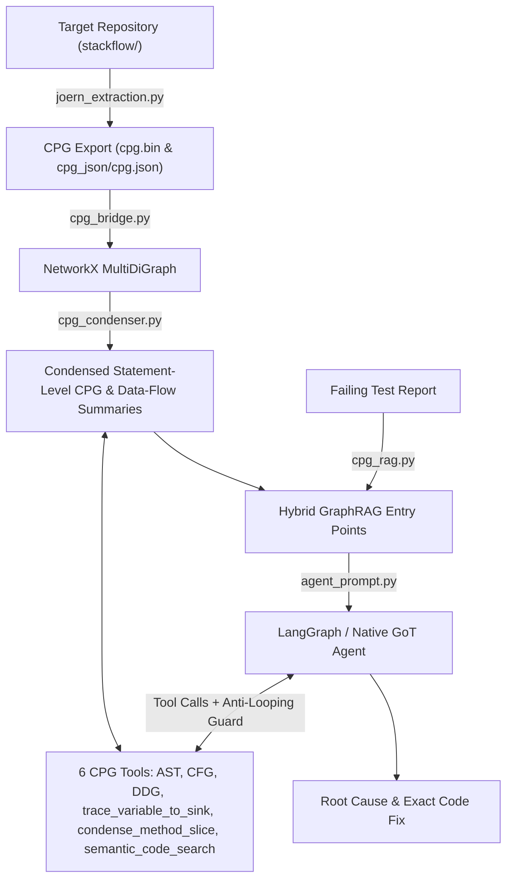

# GDAC: Graph-Driven Autonomous Code Debugging Agent

**GDAC** is an autonomous software debugging system that combines **Code Property Graph (CPG)** static analysis (via [Joern](https://joern.io/) and [NetworkX](https://networkx.org/)) with a **Graph of Thoughts (GoT)** reasoning loop powered by LangGraph/LangChain and 4-bit/8-bit quantized LLMs (e.g., `Qwen/Qwen2.5-Coder-7B-Instruct`).

Unlike traditional coding agents that rely on raw file browsing or full-codebase context windows, GDAC operates under a strict **Blind Inspection Constraint**: the agent cannot view raw source files directly and must diagnose bugs purely by querying the repository's Code Property Graph (AST, CFG, and Data Dependence Graph).

---

## Key Features & Architecture

1. **Joern CPG14 Extraction Pipeline (`joern_extraction.py`)**
   - Parses a target software repository into a binary CPG (`cpg.bin`) using `joern-parse`.
   - Exports CPG14 Graphviz `.dot` files via `joern-export` and compiles them into a consolidated JSON representation (`cpg_json/cpg.json`).

2. **NetworkX CPG Bridge & Multi-Modal Graph Traversals (`cpg_bridge.py`)**
   - Loads exported CPG14 JSON or `.dot` files into a directed multigraph (`nx.MultiDiGraph`).
   - Provides three foundational graph traversal primitives plus an algorithmic macro-tool:
     - **AST Traversal (`traverse_ast`)**: Explores syntactic hierarchy, method signatures, parameters, and nested expressions.
     - **CFG Traversal (`traverse_cfg`)**: Follows `CFG` edges to trace runtime execution order, conditional branches, and reachability.
     - **Data Flow Traversal (`traverse_data_flow`)**: Follows `REACHING_DEF`, `DDG`, `ARGUMENT`, and `REF` edges to track variable definitions and mutations.
     - **Macro-Tool (`trace_variable_to_sink`)**: Offloads multi-hop data-flow pathfinding to NetworkX (`nx.all_simple_paths` / `nx.shortest_path`), tracing a variable from its declaration/parameter origin to terminal sinks (`RETURN`, `METHOD_RETURN`) in a single call.

3. **Language-Agnostic CPG Condenser & Program Slicing (`cpg_condenser.py`)**
   - Works generically across **all Joern CPG14 frontends** (C/C++, Java, JS/TS, Go, Rust, Python, Kotlin, PHP, C#) using standard CPG14 node labels (`METHOD`, `BLOCK`, `CALL`, `CONTROL_STRUCTURE`, `RETURN`) and universal `<operator>.*` semantics.
   - **`condense_cpg(G: nx.MultiDiGraph) -> nx.MultiDiGraph`**: Collapses sub-expression AST nodes into statement-level CFG/DDG nodes (~80% global node and edge reduction) and computes a fast **Node Data-Flow Summary** (`reads`, `writes`, `calls`) for every `METHOD` node.
   - **`condense_method_slice(G, method_id, target_vars, token_budget)`**: Uses `REACHING_DEF`/`DDG` and `CFG`/`CDG` edges to keep only statements lying on the backward/forward slice of `target_vars`, folding non-causal blocks into single-line `# [condensed block: N statements]` markers within `token_budget` (~94–96% context token savings).

4. **Hybrid GraphRAG Entry Point Discovery (`cpg_rag.py`)**
   - Indexes non-compiler `METHOD` nodes, parent `TYPE_DECL` classes, signatures, precomputed `data_flow_summary` (`reads`, `writes`, `calls`), and AST-extracted docstrings.
   - **Dense Mode**: Uses `sentence-transformers/all-MiniLM-L6-v2` cosine similarity when running with GPU/Colab packages installed.
   - **Lexical Fallback**: Uses pure-Python sub-token TF-IDF / BM25 scoring with camelCase/snake_case splitting and implementation-method boosting when offline.
   - Automatically injects top semantic entry points into the agent's initial prompt and exposes a dynamic `semantic_code_search` tool.

5. **Graph of Thoughts (GoT) Reasoning & Anti-Looping Guards (`agent_prompt.py`, `agent_tools.py`, `agent_langchain.py`)**
   - Enforces a structured multi-stage reasoning workflow:
     `Hypothesis` $\rightarrow$ `AST Discovery` / `Program Slicing` / `CFG Path Tracing` $\rightarrow$ `Data Flow Analysis` $\rightarrow$ `Synthesis & Deduction` $\rightarrow$ `Exact Code Remediation`.
   - **Stateful Anti-Looping Interceptor**: Both the native `ToolMemoryBuffer` and the LangGraph `CPGDebugState` track visited node IDs and `(tool_name, target, var_name)` call signatures, intercepting duplicate tool calls to force forward progress.

6. **Dual Execution Runtimes (`agent_runner.py`, `agent_langchain.py`)**
   - **LangGraph Stateful Agent (`--framework langchain`)**: Uses `StateGraph(CPGDebugState)` with `MemorySaver` checkpointing, Pydantic-validated `StructuredTool` bindings (`agent_langchain_tools.py`), and a custom `LocalHuggingFaceChatModel` wrapper. Automatically condenses the CPG on load (disable with `--no-condense`).
   - **Native Loop (`--framework native`)**: Direct ChatML prompt formatting and regex tool-call extraction loop.
   - **Dry-Run Simulation (`--dry-run`)**: Deterministic local simulation (`MockGoTChatModel` / `run_mock_agent`) for testing the entire CPG + GoT pipeline without a GPU.

---

## System Workflow



---

## Project Structure

```text
GDAC/
├── joern_extraction.py       # CLI pipeline: runs joern-parse & joern-export, builds cpg_json/cpg.json
├── cpg_bridge.py             # NetworkX CPG loader & AST/CFG/DDG/macro traversal implementations
├── cpg_condenser.py          # Language-agnostic CPG condenser, method data-flow summaries, and program slicing
├── cpg_rag.py                # Hybrid GraphRAG (SentenceTransformers dense + TF-IDF lexical fallback)
├── agent_prompt.py           # Graph of Thoughts (GoT) system prompt & user prompt templates
├── agent_tools.py            # JSON Schema tool definitions, node resolution, ToolMemoryBuffer, dispatcher
├── agent_langchain_tools.py  # Pydantic schemas & LangChain StructuredTool bindings (6 tools)
├── agent_langchain.py        # LangGraph StateGraph, LocalHuggingFaceChatModel, MockGoTChatModel
├── agent_runner.py           # Main CLI entry point (4-bit/8-bit model loader, LangGraph/native/dry-run modes)
├── colab_agent.ipynb         # End-to-end Google Colab notebook for T4/A100 GPU execution
├── cpg.bin                   # Pre-extracted Joern binary CPG for the stackflow benchmark
├── cpg_json/                 # Exported CPG14 .dot files (0-cpg.dot .. 205-cpg.dot) and consolidated cpg.json
├── stackflow/                # Target benchmark Python package containing intentional bugs
│   ├── stackflow/
│   │   ├── models.py         # Item and Transaction dataclasses
│   │   ├── storage.py        # JsonStorage persistence layer
│   │   ├── inventory.py      # InventoryManager (contains Bug #1 in apply_discount)
│   │   └── reports.py        # InventoryReporter (contains Bug #2 in generate_category_summary)
│   └── tests/
│       ├── test_inventory.py # Unit tests exposing the discount calculation bug
│       └── test_reports.py   # Unit tests exposing the category summary overwrite bug
└── tests/
    ├── test_cpg_condenser.py   # Unit & optimization benchmark tests (including C/C++ CPG test)
    └── test_langchain_agent.py # Automated pytest suite for Pydantic schemas, 6 CPG tools, LangGraph & anti-looping
```

---

## Benchmark Target: `stackflow` & Seeded Bugs

The repository includes **`stackflow`**, a modular Python inventory management and reporting package with pre-extracted CPG data in `cpg_json/` and two seeded logic defects used to evaluate the debugging agent:

| Bug Scenario (`--target`) | Location | Failing Test | Root Cause | Expected Fix |
| :--- | :--- | :--- | :--- | :--- |
| **`discount`** | `stackflow/inventory.py` (`InventoryManager.apply_discount`, line 84) | `test_apply_discount` (`AssertionError: 20.0 != 80.0`) | Multiplies price by `discount_percent / 100.0` (computing the discount amount rather than the discounted price). | `item.price = round(item.price * (1.0 - (discount_percent / 100.0)), 2)` |
| **`summary`** | `stackflow/reports.py` (`InventoryReporter.generate_category_summary`, line 34) | `test_generate_category_summary_aggregates_multiple_items` (`AssertionError: 250.0 != 1000.0`) | Overwrites `summary[item.category] = round(item_total, 2)` on each loop iteration instead of accumulating. | `summary[item.category] = round(summary.get(item.category, 0.0) + item_total, 2)` |

---

## Installation & Prerequisites

### 1. Python Dependencies

Install the core and agent packages:

```bash
pip install networkx pydantic langchain langchain-core langgraph pytest
```

For local/Colab GPU inference and dense GraphRAG embeddings, also install:

```bash
pip install torch transformers bitsandbytes accelerate sentence-transformers
```

### 2. Joern CLI (Optional — only needed to re-extract CPGs)

Pre-extracted CPG files (`cpg.bin` and `cpg_json/cpg.json`) are already included in the repository. To run `joern_extraction.py` on new code, ensure Java (JRE 21+) and [Joern](https://joern.io/) (`joern-parse`, `joern-export`) are installed and available on your `PATH`.

---

## Usage

### 1. Run the Autonomous Agent in Dry-Run Mode (No GPU Required)

Simulate the full Graph of Thoughts loop over the real `cpg_json` graph using the LangGraph runtime:

```bash
# Scenario 1: Discount calculation bug
python agent_runner.py --cpg-path cpg_json --dry-run --framework langchain --target discount

# Scenario 2: Category summary aggregation bug
python agent_runner.py --cpg-path cpg_json --dry-run --framework langchain --target summary
```

Or run the native dry-run walkthrough (which also demonstrates deterministic anti-looping interception):

```bash
python agent_runner.py --cpg-path cpg_json --dry-run --framework native --target discount
```

### 2. Run with a Quantized LLM (GPU / Google Colab)

Run the agent with `Qwen/Qwen2.5-Coder-7B-Instruct` loaded in 4-bit NF4 quantization (~5.5 GB VRAM):

```bash
python agent_runner.py \
  --cpg-path cpg_json \
  --model Qwen/Qwen2.5-Coder-7B-Instruct \
  --quantization 4bit \
  --framework langchain
```

You can also open `colab_agent.ipynb` in Google Colab to run the interactive notebook on a T4 or A100 GPU.

### 3. Inspect the CPG Bridge Directly

Run the standalone NetworkX bridge CLI to inspect AST, CFG, and Data Flow traversals on any method in `cpg_json`:

```bash
python cpg_bridge.py --cpg-path cpg_json --method apply_discount
```

### 4. Extract a CPG from a Repository

Regenerate `cpg.bin` and `cpg_json/cpg.json` from `stackflow` (or another repository):

```bash
python joern_extraction.py --repo stackflow --cpg-bin cpg.bin --out cpg_json
```

---

## Running Tests

### Verify the LangChain / LangGraph Agent & CPG Tools

From the project root:

```bash
pytest tests/test_langchain_agent.py
```

### Run the Benchmark Target Suite (`stackflow`)

Running pytest inside `stackflow/` will intentionally fail on the two seeded bugs (`test_apply_discount` and `test_generate_category_summary_aggregates_multiple_items`):

```bash
pytest stackflow/tests
```
